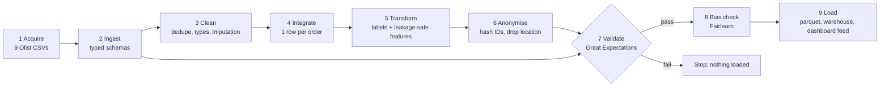

# DRI Data Pipeline (Module 3)

One command turns the nine raw Olist files into a validated, pseudonymised, bias-checked table with one row per order, ready for model training in Module 4.

```bash
pip install -r requirements-pipeline.txt
python -m src.pipeline.flow          # downloads the data if missing, then runs all 9 stages
pytest -q                            # 21 unit tests on synthetic (Faker) data
docker build -t dri-pipeline . && docker run --rm -v "$PWD/data:/app/data" dri-pipeline
```

## Stages (Prefect flow `dri-etl`, `src/pipeline/flow.py`)



| # | Stage | Code | What it does | Rows out (run 11 Nov 2026) |
| --- | --- | --- | --- | --- |
| 1 | Acquire | `ingest.download_missing` | Downloads any missing source file; logs its SHA-256 | 9 files |
| 2 | Ingest | `ingest.load_all` | Reads every table with explicit string and date types | 1,550,922 rows across 9 tables |
| 3 | Clean | `clean.py` | Drops duplicates and free text, fixes types, imputes product sizes, collapses geolocation | 569,144 rows across 8 tables |
| 4 | Integrate | `integrate.py` | Aggregates items and payments per order, then joins customers, sellers, reviews and coordinates | 99,441 orders × 34 columns |
| 5 | Transform | `src/features/build.py` | Builds 5 label and outcome columns and 30 tagged features (27 known at purchase, 3 at hand-over), including point-in-time seller history | 99,441 × 54 |
| 6 | Anonymise | `anonymize.py` | Salted SHA-256 keys; deletes postcodes, coordinates and raw IDs; allow-list of columns | 99,441 × 41 |
| 7 | Validate | `validate.py` | 3 suites, 35 expectations; the model-ready suite is a hard gate | 35 / 35 passed |
| 8 | Bias check | `src/fairness/bias.py` | Representation and base-rate checks by region and seller size | 3 regions flagged |
| 9 | Load | `load.py` | Parquet file, warehouse table plus training view, suppressed dashboard feed | 99,441 / 96,470 in view |

## Data-quality decisions (counts from the real run)

| Issue found | Count | Decision |
| --- | --- | --- |
| Geolocation duplicate rows | 280,007 of 1,000,163 | Removed; then one median point per postcode prefix (19,010 prefixes) |
| Coordinates outside Brazil | 33 | Removed |
| Timestamps out of order (e.g. carrier before approval) | 1,382 orders | Kept and flagged `ts_anomaly`; negative durations set to missing |
| Several reviews for one order | 551 | Latest answer kept (one outcome per order) |
| Payments with type `not_defined` | 3 | Removed |
| Products with no category | 610 | Labelled `unknown` |
| Products with missing or zero size/weight | 6 | Category median imputed; flagged `size_imputed` |
| Orders with no items | 775 | Kept (mostly cancelled or unavailable); excluded from the training view by having no label |
| Delivered orders missing a delivery date | 8 | No label; excluded from training view |
| Postcode not found in geolocation | 280 customers, 992 sellers | Fell back to the state's median point |
| Orders that never reached the customer | 2,971 | No `is_late` label; outside the 96,470-order training view |

## Outputs

| Output | Location | Use | Access |
| --- | --- | --- | --- |
| Model-ready table | `data/processed/orders_model_ready.parquet` | Module 4 training and testing | Restricted |
| Warehouse table + view | `orders_model_ready`, `v_training_delivered` at `DATABASE_URL` | SQL access; view holds the 96,470 labelled orders | Restricted |
| Dashboard feed | `data/processed/dashboard_feed.csv` | Module 5 dashboard (region × month × category) | Internal; cells under 5 orders suppressed |
| Evidence | `docs/evidence/` | Lineage, bias report, audit log sample, screenshots | Project team |

## Lineage

Every run writes `docs/evidence/lineage.json` (stage, inputs, output, rows, columns, time, decisions) and appends to `logs/audit.log`. Column-level lineage for features is in the [data dictionary](data_dictionary.md) (section 4), and each feature's availability tag (P, H or O) is checked by `tests/test_features.py`.

## Evidence

- Prefect run graph: `docs/evidence/screenshots/prefect_flow_run.png`
- Great Expectations Data Docs: `docs/evidence/screenshots/gx_validation_*.png`, including `gx_validation_gate_blocks_pii_leak.png` (the gate failing on purpose when a postcode column leaks)
- Bias report: `docs/evidence/bias_region.csv`, `bias_seller_size.csv`, `bias_summary.json`
- Privacy audit log sample: `docs/evidence/audit_log_sample.jsonl`
