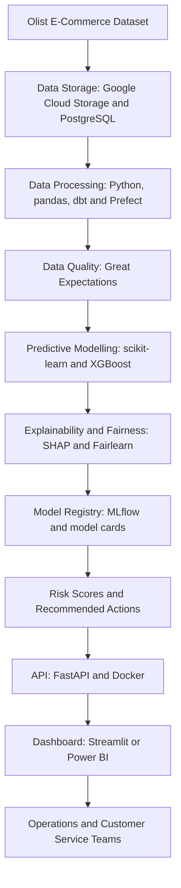

# Delivery Risk Intelligence (DRI)
## Proposed Technical Architecture

### 1. Architecture Overview

Delivery Risk Intelligence (DRI) is a proposed predictive analytics solution designed to identify orders at risk of late delivery and recommend appropriate operational interventions.

The project uses the historical Olist Brazilian E-Commerce dataset for research and development. The insights may inform future logistics applications, including transport, ICD and CFS operations at HESU Investment Limited. The Olist data does not represent HESU's actual operational records.

### 2. System Architecture

### 3. Main Technology Components

| Component | Proposed Technology | Purpose |
|---|---|---|
| Data source | Olist dataset | Historical order and delivery information |
| Storage | Google Cloud Storage, PostgreSQL | Store and organise project data |
| Data processing | Python, pandas, dbt, Prefect | Prepare and transform data |
| Data quality | Great Expectations | Validate dataset quality |
| Machine learning | scikit-learn, XGBoost | Predict late-delivery risk |
| Explainability | SHAP | Explain model predictions |
| Fairness | Fairlearn | Evaluate regional and seller-related fairness |
| Experiment tracking | MLflow | Track model experiments and register approved versions |
| API | FastAPI, Docker | Make predictions accessible to applications |
| Dashboard | Streamlit or Power BI | Present risk insights to users |
| Version control | GitHub, DVC | Track code and dataset versions |
| Testing and CI | pytest, ruff, GitHub Actions | Run checks on every push and pull request |

### 4. Components and Repository Folders

Each component maps to a folder in the Module 1 repository structure.

| Layer | Component | Repository folder |
|---|---|---|
| Ingest and store | Raw Olist files (versioned with DVC) | `data/raw/` |
| Ingest and store | Prefect ingest flow with Great Expectations checks | `src/pipeline/` |
| Transform | PostgreSQL staging tables and dbt models | `data/processed/`, `src/pipeline/` |
| Transform | Feature tables (prediction-time fields only) | `src/features/` |
| Model and audit | Training and evaluation (scikit-learn, XGBoost) | `src/models/`, `notebooks/` |
| Model and audit | SHAP explanations and Fairlearn report | `src/fairness/` |
| Model and audit | MLflow registry and model cards | `docs/model_cards/` |
| Serve and act | Scoring API (FastAPI, Docker, Cloud Run) | `api/` |
| Serve and act | Recommendation engine | `src/actions/` |
| Serve and act | Streamlit dashboard and Power BI export | `dashboard/` |
| Across all layers | Automated checks | `tests/`, `.github/workflows/` |

**Two scoring points.** Each order is scored at purchase, using fields tagged P in the data dictionary, and again at carrier hand-over, using fields tagged P and H. Fields tagged O (outcomes) never reach `src/features/`; this is the leakage gate.

### 5. Data Flow

1. Historical order and delivery records are obtained from the Olist dataset.
2. Data is stored and processed for analysis.
3. Quality checks identify missing, inconsistent or invalid records.
4. Relevant features are created using information available at prediction time.
5. Machine learning models estimate the probability of late delivery.
6. Explainability and fairness checks support responsible use.
7. The system generates risk scores and suggested operational actions.
8. A dashboard presents the results for human review and decision-making.

### 6. Security and Responsible AI

The proposed solution will follow data minimisation, access control and responsible AI principles. Model performance will be evaluated across relevant customer regions and seller groups.

Predictions will support operational decisions rather than automatically penalising sellers or delivery partners.

### 7. Implementation Status

This document describes the planned architecture for the BAN6800 academic project. The technologies and integrations listed are proposed components and will be implemented and validated progressively during subsequent project modules.
